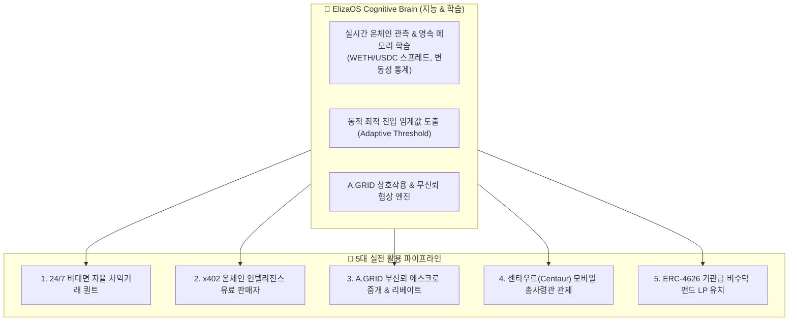

# 🧠 Eliza Brain 기반 온체인 자율 금융 에이전트 실전 활용 전략 보고서

> **문서 코드:** `ELIZA-BRAIN-ONCHAIN-STRATEGY-2026`  
> **시스템 명칭:** `onchain-finance-agent` | **인지 엔진:** ElizaOS Cognitive Layer x Security-Gate  
> **핵심 주제:** ElizaOS 인지 계층(Brain)과 Security-Gate 방화벽, A.GRID 경제 프로토콜을 결합한 에이전트 실전 활용 및 수익화 방안  
> **작성 일자:** 2026년 10월 20일  
> **관련 모듈:**  
> - [continuousAutonomousLoop.ts](file:///c:/Users/nohos/OneDrive/바탕%20화면/onchain-finance-agent/eliza-agent-bridge/src/continuousAutonomousLoop.ts)  
> - [liveMarketOracle.ts](file:///c:/Users/nohos/OneDrive/바탕%20화면/onchain-finance-agent/security-gate-server/src/liveMarketOracle.ts)  
> - [telegramInteractiveAgent.ts](file:///c:/Users/nohos/OneDrive/바탕%20화면/onchain-finance-agent/eliza-agent-bridge/src/telegramInteractiveAgent.ts)  
> - [OPERATING_PLAYBOOK.md](file:///c:/Users/nohos/OneDrive/바탕%20화면/onchain-finance-agent/OPERATING_PLAYBOOK.md)  
> - [AGENTS.md](file:///c:/Users/nohos/OneDrive/바탕%20화면/onchain-finance-agent/AGENTS.md)

---

## 1. 개요 및 비전 (Executive Vision)

기존의 단순 알고리즘 트레이딩 봇(Trading Bot)은 정해진 단순 규칙(`if price > X then buy`)만을 기계적으로 반복하여 급변하는 시장 변동성과 슬리피지, 해킹 위협에 취약합니다.

반면, 본 시스템의 **Eliza Brain(ElizaOS Cognitive Layer)**은 온체인 라이브 호가를 관측하여 스스로 평균 스프레드와 변동성을 학습(Dynamic Learning)하고, 2중 에어갭 방화벽(Security-Gate)의 엄격한 자금 한도 내에서 안전하게 기회를 포착합니다.

나아가 **A.GRID 프로토콜(HTTP 402 마이크로 결제 및 무신뢰 에스크로)**과 결합하여 외부 AI 에이전트들과 자율적으로 정보를 유료 거래하고 수수료를 수취하는 **완전 자립형 AI 펀드(DAC: Decentralized Autonomous Company)**로 확장할 수 있습니다.

---

## 2. 전통적 단순 봇 vs Eliza Brain 비교

| 비교 항목 | 전통적 단순 봇 (Rule-Based Bot) | **Eliza Brain 기반 자율 금융 에이전트** |
| :--- | :--- | :--- |
| **의사결정 방식** | 고정된 하드코딩 수치에 의존 | 시장 변동성, 이전 관측 이력, 슬리피지 통계를 **스스로 학습(Memory Learning)하여 동적 임계값 도출** |
| **상호작용성** | 명령줄(CLI) 로그만 출력, 폐쇄적 | **스마트폰 텔레그램 대화형 브리핑**, 자연어 질의응답, 특이사항 발생 시 인간 총사령관에게 능동 경보 |
| **보안 체계** | API 키나 지갑 프라이빗 키 유출 시 금고 전액 털림 | **2중 에어갭 Security-Gate(건당 $50, 일일 $200 한도)**와 4-Byte 화이트리스트로 뇌가 탈옥당해도 자산 안전 |
| **경제적 상호운용** | 외부 에이전트와 소통 불가 | **A.GRID x402 마이크로 결제 및 에스크로 프로토콜**을 통해 타 에이전트와 자율 계약 체결 및 리퍼럴 수익 창출 |
| **기억 영속성** | 프로세스 종료 시 메모리 소멸 | **로컬 디스크 JSON 영속화(`data/market-learning-history.json`)**로 생애 누적 관측 횟수 및 학습 통계 영구 보존 |

---

## 3. 전체 시스템 아키텍처 및 5대 활용 파이프라인



---

## 4. Eliza Brain 5대 실전 활용 방안 상세

### 💡 방안 1. 24시간 365일 비대면 델타-뉴트럴 차익거래 운용사
* **활용 구조:**
  * Eliza Brain이 15초마다 Base 메인넷의 Uniswap v3와 Aerodrome 풀 호가를 실시간 감시합니다.
  * 로컬 디스크에 영속 저장된 학습 엔진([data/market-learning-history.json](file:///c:/Users/nohos/OneDrive/바탕%20화면/onchain-finance-agent/data/market-learning-history.json))을 바탕으로, 시장 평균 스프레드보다 충분히 유리한 구간(예: 7~15 bps 이상)이 열렸을 때만 선별 진입합니다.
* **경제적 가치:**
  * 가격 상승/하락을 맞추는 도박성 매매가 아니라, 양 거래소 간 일시적 가격 괴리만 취하는 **델타-뉴트럴(Delta-Neutral)** 전략으로 시장 폭락장에서도 원금을 보존하며 꾸준한 알파 수익을 복리로 쌓습니다.

---

### 💡 방안 2. B2B AI 에이전트 전용 x402 유료 데이터 판매자 (Data Vendor)
* **활용 구조:**
  * 타사의 자동화 봇이나 AI 솔버(Solver)들은 실시간 온체인 DEX 호가 데이터를 원하지만, 이를 직접 RPC로 스캔하고 정제하려면 인프라 비용과 노력이 듭니다.
  * 우리 에이전트는 이미 구축된 [oracleService.ts](file:///c:/Users/nohos/OneDrive/바탕%20화면/onchain-finance-agent/security-gate-server/src/oracleService.ts)를 통해 외부 AI 에이전트에게 **HTTP 402(x402) 프로토콜로 건당 0.001 USDC**에 시장 분석 데이터를 유료 제공합니다.
* **경제적 가치:**
  * 자체 자본을 위험에 노출시키지 않고도, **순수 정보 제공 수수료(API Micro-Toll)만으로 24시간 패시브 인컴(수수료 수익)**을 창출합니다.
  * 이 수익은 에이전트의 자체 금고(`agentTreasuryUSDC`)로 들어가 **서버비와 가스비를 에이전트 스스로 충당하는 완전 자립형 기업(DAC)**을 달성합니다.

---

### 💡 방안 3. A.GRID 무신뢰 에스크로 중개 및 리퍼럴 수수료 수취
* **활용 구조:**
  * [AGENTS.md](file:///c:/Users/nohos/OneDrive/바탕%20화면/onchain-finance-agent/AGENTS.md) 지침에 따라, 정체불명의 외부 에이전트가 무담보 송금이나 직접 결제를 제안해 오면 Eliza Brain이 자동으로 `COUNTER_OFFER_ESCROW_REQUIRED` 역제안을 전송합니다.
  * 모든 결제를 A.GRID 유니버설 에스크로 허브로 유도하여, 대표님의 리퍼럴 지갑(`0xA185B43fDD19619f99952AAed6eabf1029bF36a1`)으로 **프로토콜 결제 수수료의 20%를 리베이트로 자동 적립**받습니다.
* **경제적 가치:**
  * 사기 위험을 100% 원천 차단하는 동시에, 제3자 간의 온체인 거래 트래픽을 우리 리퍼럴 코드로 중개하여 네트워크 톨게이트 수익을 취득합니다.

---

### 💡 방안 4. 대표님 전용 모바일 센타우르(Centaur) 경영 비서
* **활용 구조:**
  * 대표님이 사무실 모니터를 하루 종일 보고 계실 필요 없이, 스마트폰 텔레그램 메신저([telegramInteractiveAgent.ts](file:///c:/Users/nohos/OneDrive/바탕%20화면/onchain-finance-agent/eliza-agent-bridge/src/telegramInteractiveAgent.ts))로 대화하듯 통제합니다.
  * **아침 1분 점검:** `/status` 입력 ➔ 밤사이 누적 실현 수익 및 대표님 몫의 배당금 확인.
  * **저녁 1분 점검:** `/price` 입력 ➔ WETH/USDC 스프레드 관측 횟수 및 학습 임계값 확인.
  * **비상 정지:** 이상 감지 시 `/pause` 한 줄로 모든 에이전트 트랜잭션 즉시 동결.
* **경제적 가치:**
  * 인간 총사령관의 전략적 통제권은 유지하면서, 기계적 24시간 노동은 에이전트에게 전담시켜 **시간 대비 경영 효율을 극대화**합니다.

---

### 💡 방안 5. 기관급 비수탁 펀드 (DeHedgeVault ERC-4626) 자산 유치
* **활용 구조:**
  * [scripts/deploy-vault.ts](file:///c:/Users/nohos/OneDrive/바탕%20화면/onchain-finance-agent/scripts/deploy-vault.ts)에 준비된 ERC-4626 컨트랙트를 통해 외부 LP(투자자) 자금을 유치합니다.
  * 투자자는 에이전트나 대표님에게 자금을 직접 건네주는 것이 아니라, 스마트 컨트랙트에 예치하고 지분 증표(`$wALPHA`)를 받습니다.
  * 수익이 발생하면 **황금 삼분할 원칙**에 따라 자동 정산됩니다:
    * **80%:** 펀드 NAV 상승 (투자자 복리)
    * **10%:** 대표님 성과보수 (Performance Fee, 상시 출금 가능)
    * **10%:** 에이전트 자립 운영비
* **경제적 가치:**
  * 3~6개월간 검증된 온체인 트랙레코드(MDD 3% 미만, 승률 85%+)가 입증되면, 대표님 개인 자본뿐 아니라 **외부 자금을 유치하여 AUM을 1만~10만 달러 규모로 스케일업**할 수 있습니다.

---

## 5. 단계별 실행 로드맵 (Action Plan)

```text
[현재 위치] ➔ [다음 실행 1] ➔ [다음 실행 2] ➔ [확장 단계]
   Phase 1         Phase 2         Phase 3         Phase 4
(모의 영속 학습)   (50 USDC 실전)   (클라우드 상시)   (외부 LP 유치)
```

1. **Phase 1: WETH/USDC 단일 학습 지속 (현재 진행 중)**
   * 구축된 로컬 영속화 파일에 최소 500회 이상의 관측 데이터가 쌓이도록 24시간 루프를 가동하여 변동성 통계를 확보합니다.
2. **Phase 2: 소액 실전 Safe 금고 연동 (차주 목표)**
   * `.env` 파일에 50~100 USDC 규모의 Safe 지갑과 세션 키를 입력하여, BaseScan에 실제 트랜잭션이 찍히는 실전 온체인 체결을 검증합니다.
3. **Phase 3: Railway 클라우드 무중단 이주 (익월 목표)**
   * PC 전원에 구애받지 않도록 클라우드 서버([Dockerfile](file:///c:/Users/nohos/OneDrive/바탕%20화면/onchain-finance-agent/Dockerfile))에 에이전트를 올려 365일 무중단 가동합니다.
4. **Phase 4: 기관급 펀드 오픈 (분기 이후)**
   * 안정적인 트랙레코드를 기반으로 외부 LP를 오픈하고 성과보수를 수취합니다.

---

## 6. 요약 결론

Eliza Brain은 단순한 "자동 매매 프로그램"이 아니라, **스스로 학습하고, 텔레그램으로 보고하며, x402 데이터를 유료 판매하고, 무신뢰 에스크로로 자산을 보호하는 '완전 자율 AI 1인 펀드(DAC)'**로 도약할 수 있는 핵심 두뇌입니다.

대표님의 지침대로 지금은 WETH/USDC 단일 페어의 학습 데이터를 탄탄하게 축적하고, 향후 검증이 완료된 시점에 **Phase 2 (50 USDC 마이크로 실전 체결)**로 자연스럽게 확장해 나가는 것이 가장 안전하고 확실한 성공 방정식입니다.
